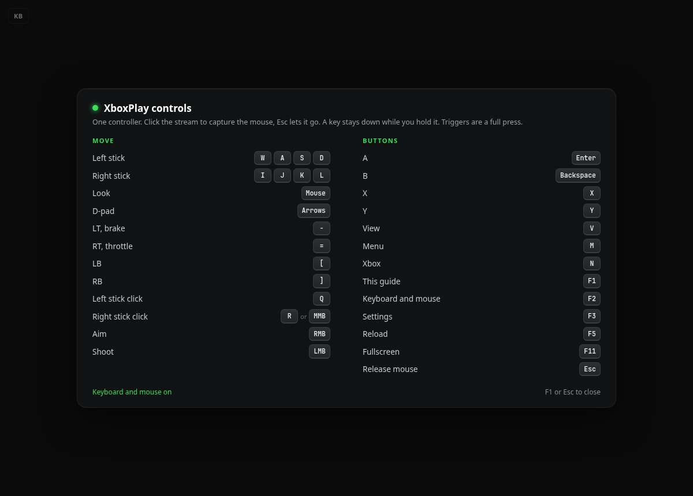
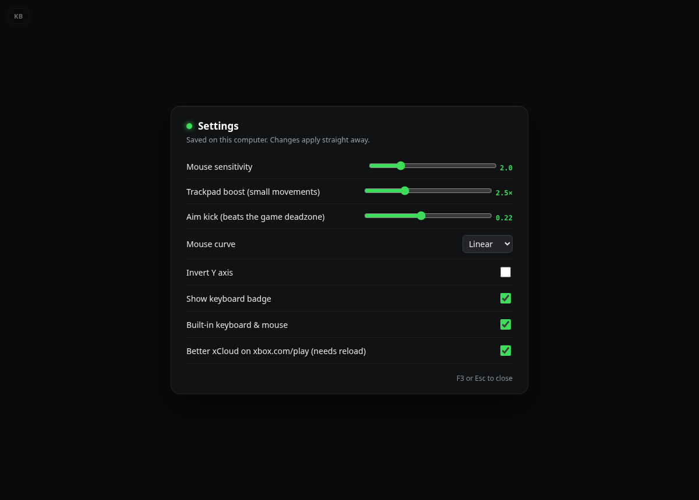

# XboxPlay

Xbox remote play and Xbox Cloud Gaming in a window on Linux, with a controller or the keyboard and mouse.

I built this because Greenlight wouldn't connect on my work network, while xbox.com/play in Chrome worked fine. This is that site in an Electron window, plus a keyboard and mouse layer that looks like a controller to the game.

Not affiliated with or endorsed by Microsoft. Xbox is a trademark of Microsoft. You still need your own Xbox account, and Game Pass for cloud games.





## Install

Debian, Ubuntu, Parrot, and anything else with apt. One command:

```bash
curl -fsSL https://raw.githubusercontent.com/WastedPatriot/xboxplay/main/install.sh | bash
```

It installs git and Node with apt if they're missing, clones this repo to `~/xboxplay`, runs `npm ci`, and adds an `xboxplay` command and an app menu entry. It asks for sudo once, to set up Chromium's sandbox helper. Run the same line again to update.

If you'd rather read it first, download `install.sh`, look through it, then run `bash install.sh`.

The other way is an AppImage. Nothing is attached until a `v*` tag is pushed (see [Releases](https://github.com/WastedPatriot/xboxplay/releases)). After `v1.0.0` exists:

```bash
curl -fL -o XboxPlay.AppImage "https://github.com/WastedPatriot/xboxplay/releases/latest/download/XboxPlay-1.0.0.AppImage" && chmod +x XboxPlay.AppImage && ./XboxPlay.AppImage
```

That same release also has a `.deb` and an `.rpm`.

## Features

- Remote play to your console, and cloud games, in one window.
- A plugged-in gamepad is passed through when the browser reports it as a standard pad.
- Keyboard and mouse act as one Xbox pad. F2 turns that off.
- F1 is the control list. F3 is sensitivity, trackpad boost, aim kick, the mouse curve, and invert Y.
- On the old `www.xbox.com/play` site it can load Better xCloud, pinned to one version and checked with a SHA-256 before it runs.
- No telemetry of its own.

## Controllers

| What you have | What you need |
|---|---|
| 8BitDo pad with the standard mapping. The Ultimate 2C over USB is `2dc8:310a` on `xpad`. | Plug it in. Your user should be in the `input` group. This app does not install the driver. |
| Xbox pad, USB | `xpad`, or `xone` for many Series pads. |
| Xbox pad, Bluetooth | `xpadneo`, or the kernel HID driver. |
| Keyboard and mouse | Nothing extra. F2 turns it off. It uses a free controller slot, so a real pad and the keyboard can both show up. |

## Keys

Sign in, go to your console (or a cloud game) and start the stream. Click the picture to capture the mouse. Esc gives it back.

The keyboard is one Xbox controller. One key does one thing, and it stays held for as long as you hold the key. The triggers go to a full press, so brake and throttle register in racing games (steer with A and D, brake with `-`, throttle with `=`).

The face buttons, triggers, view, menu and Xbox button follow Greenlight. Bumpers are Q and R. The sticks, which Greenlight leaves out, are W A S D and I J K L. Stick clicks are F and G, and the middle mouse button is also the right stick click.

| Control | Key |
|---|---|
| Left stick | W A S D |
| Right stick | I J K L, or the mouse |
| D-pad | Arrow keys |
| A | Enter |
| B | Backspace |
| X | X |
| Y | Y |
| LB | Q |
| RB | R |
| LT (full press, brake) | - |
| RT (full press, throttle) | = |
| Left stick click | F |
| Right stick click | G, or the middle mouse button |
| View | V |
| Menu | M |
| Xbox button | N |
| Aim (LT) | Right mouse button |
| Shoot (RT) | Left mouse button |

| Key | Does |
|---|---|
| F1 | Controls guide |
| F2 | Keyboard and mouse on/off |
| F3 | Settings |
| F5 | Reload |
| F11 | Fullscreen |
| Esc | Release the mouse |

F3 has mouse sensitivity (default 2), a trackpad boost for small movements, a linear or smooth mouse curve, invert Y, and the badge. They're saved in the app. `XBOXPLAY_SENS=1.5 xboxplay` also sets the sensitivity.

To change a key, copy `keymap.example.json` to `~/.config/XboxPlay/keymap.json` and edit it. Each key can only be used once. If that file is missing, isn't a normal file, or doesn't match the example, you get the table above.

## Troubleshooting

- Black screen, or the picture never comes up: the network is often blocking the UDP ports the stream uses. Try a phone hotspot. A VPN can block it the same way.
- Sandbox: the installer asks for sudo once so `chrome-sandbox` can be root-owned and setuid. If that fails, the app starts with `--no-sandbox`. The Flatpak build does that on purpose, because Flatpak is already a sandbox.
- GPU: if the window stays black or the app dies on startup, run `XBOXPLAY_SAFE=1 xboxplay`. That turns GPU acceleration off.
- "Bad Request" right after Xbox sends you to `play.xbox.com`: the app retries. Press F5 if it is still stuck. To go back to the old site: sign in, click your profile picture, Exit preview.
- No sound: click once inside the window.
- The mouse goes through a virtual stick, so aiming feels like a controller with a very fast thumb. Tune the sensitivity and curve in F3.

## FAQ

**Is this official?** No.

**Do I need Game Pass?** For cloud games, yes. Remote play needs your own console on the same account.

**Where is the login stored?** `~/.config/XboxPlay`. Uninstall keeps it unless you pass `--purge`.

**How do I update?** Run the curl line again. For the AppImage, download the newer file from the release.

**Will it run on a Steam Deck?** The AppImage is the one to try. I have not tested it there.

**Which desktops?** Debian-based distros with X11. Wayland should work, but I have not tried it much.

## Better xCloud

On the old `www.xbox.com/play` site the app also loads [Better xCloud](https://github.com/redphx/better-xcloud) (pinned to v6.7.13, checked against a SHA-256 before it runs). It doesn't work on the new `play.xbox.com` site yet, which is why the built-in keyboard and mouse exists. You can turn Better xCloud off in F3, or with `XBOXPLAY_BX=0`.

## Uninstall

```bash
bash ~/xboxplay/uninstall.sh          # keeps your login
bash ~/xboxplay/uninstall.sh --purge  # also deletes ~/.config/XboxPlay
```

An AppImage is just the file. Delete it.

## Security notes

- The window only navigates to Microsoft/Xbox sign-in and play domains (`src/config.js`). Other links open in your normal browser.
- Renderer is sandboxed with context isolation, no Node integration, no webviews. Devtools are off unless you set `XBOXPLAY_DEBUG=1`.
- Only pointer lock, fullscreen, keyboard lock, mic/camera, speaker selection and clipboard write are granted, and only to those domains.
- No telemetry of its own. Logs never include URLs' query strings.
- Your login lives in `~/.config/XboxPlay` like any browser profile.
- `keymap.json` is only read from that same folder, only if it is a regular file (not a link), and only if every entry is a known control and one key code. It is never downloaded.

Found something? See [SECURITY.md](SECURITY.md).

## License

MIT
